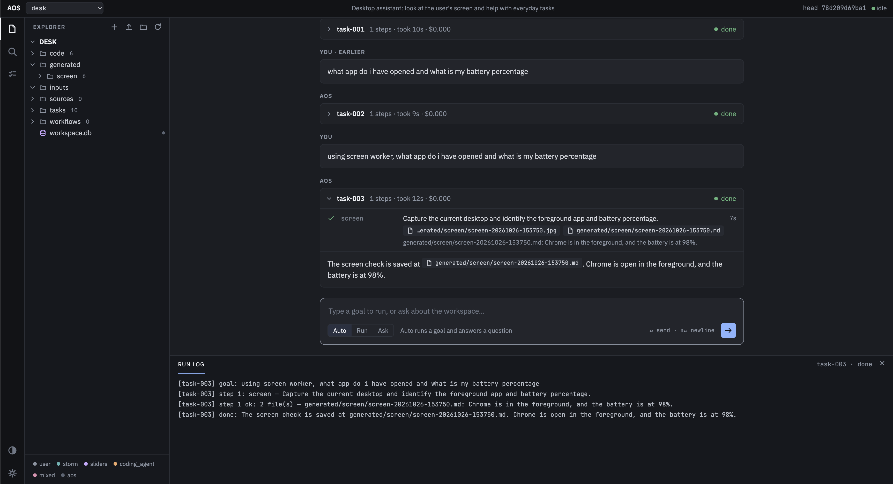

# Telemetry AI

This is an agentic workflow for manageing everyday desktop tasks and securely using system telemetry for advanced features. Currently implemeneted to run on AOS.


## Platforms

This agent uses OpenAI's SDK for LLM calls, wrapped in LangChain's DeepAgents harness for general purpose usecases and built-in filesystem tools, subagents, persistent memory, and skills.

## Setup

To setup this project, make sure you have the UV package manager installed. Then, to inititalize the virtual environment and install dependencies run:
```bash
uv init --bare
uv sync
```

## Running the agent using AOS

The agent runs on [AOS](aos/README.md) (`./aos`, a local editable dependency): every goal is planned into steps by AOS's planner, run by a worker (`screen` from `screen_worker.py`, or AOS's `coding_agent`), and recorded in the git-versioned workspace `workspaces/desk`.

*Sanity check*: Run the following command and make sure that AOS sees the `coding_agent` and `screen` workers as "avaliable":
```bash
uv run aos workers
```

To run this AOS-based agent, you can use the terminal as such:
```bash
uv run agent.py
```

Or choose to run it using the AOS UI as follows:
```bash
uv run aos ui                       # web UI at http://127.0.0.1:8765
```

`.env` needs `API_KEY` (set to `${OPENAI_API_KEY}`), `BASE_URL=https://api.openai.com/v1`,
`AOS_MODEL` and `AOS_WORKERS=screen_worker.py:Screen`. Run from the repo root so `AOS_WORKERS` resolves.